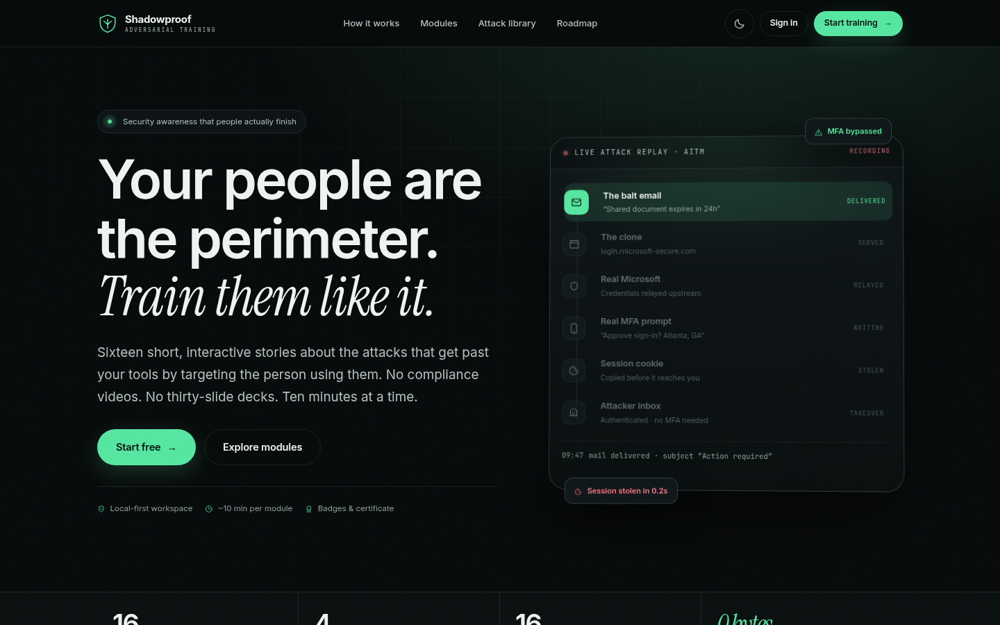
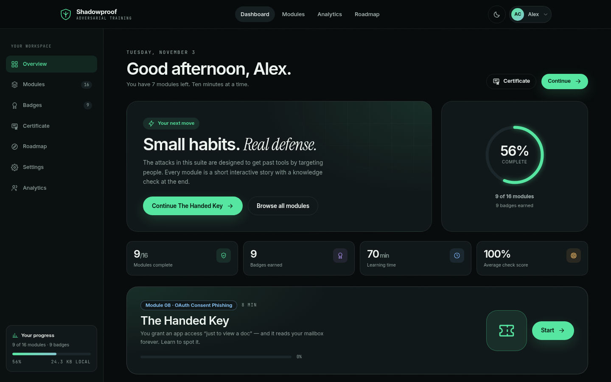
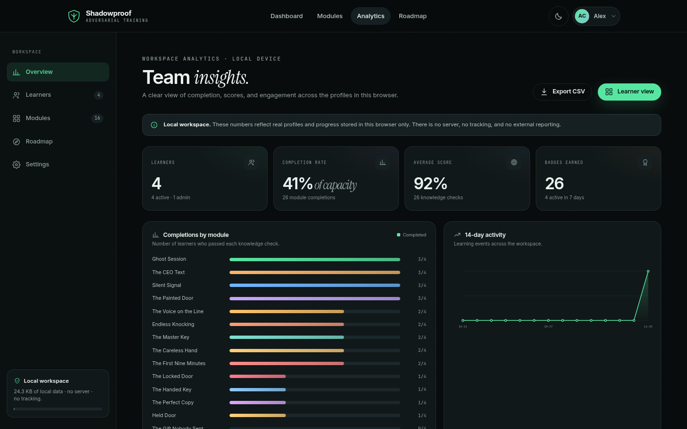
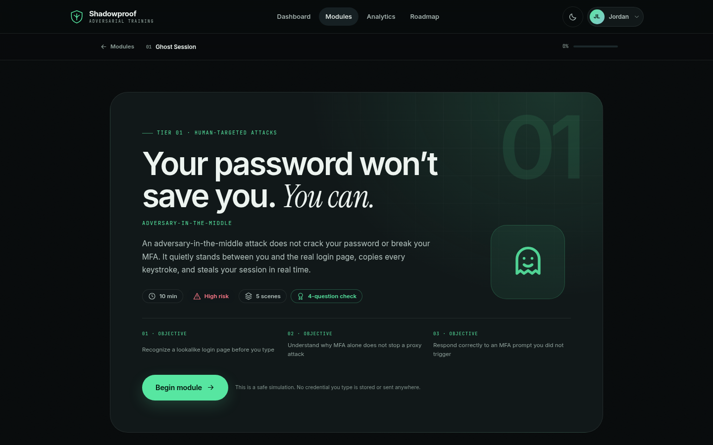
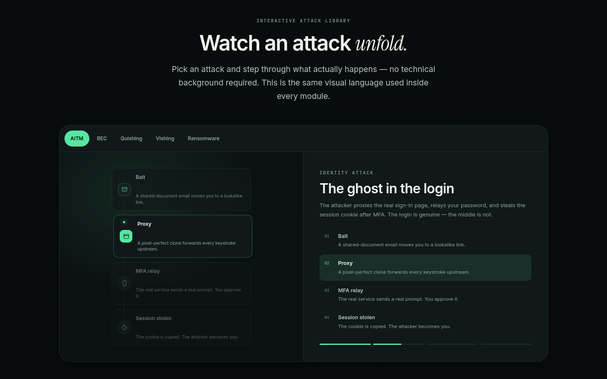
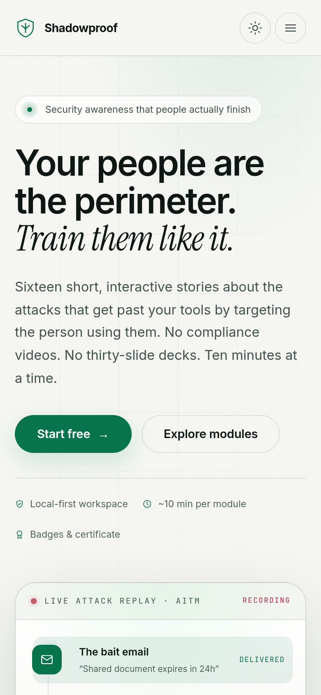
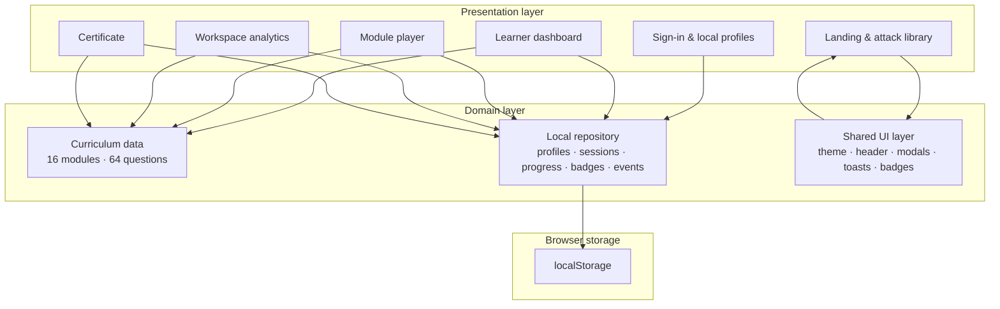

<div align="center">


# SHADOWPROOF

**Adversarial security awareness training for people who have real work to do.**

An interactive, local-first cybersecurity awareness suite built around sixteen short stories, real attack patterns, and knowledge checks that stick.

[**Live demo**](https://esperkro.github.io/AiTM) · [**Modules**](#the-curriculum) · [**Roadmap**](roadmap.html) · [**Report a bug**](https://github.com/maldevo/AiTM/issues)


</div>

---

## What is SHADOWPROOF?

SHADOWPROOF is an educational cybersecurity project developed for students of the **Cybersecurity Department at GNA University**. It turns security-awareness theory into short, playable scenarios: inspect a phishing email, sort a week of text messages, deny an MFA prompt you did not start, hang up on a vishing call, and report an incident before it spreads.

The project is intentionally **static** — plain HTML, CSS, and JavaScript with no server, database, or build step. A learner's profile, progress, badges, and workspace analytics live in their browser. This makes the project easy to host on GitHub Pages, simple to audit, and safe to use in a classroom without collecting student data.

> **Educational purpose.** The suite helps cybersecurity students understand the human layer of security: how social engineering works, why technical controls alone are not enough, and what a practical defensive habit looks like. It is a teaching artifact, not a commercial certification platform.

### Who it is for

- **Cybersecurity students** who want to see attacks from the target's point of view.
- **Faculty and lab instructors** who need a ready-to-run awareness exercise.
- **Student security clubs** running phishing-awareness workshops.
- **Small teams** that want a local-first training demo without a vendor contract.

---

### Scan to Access the Project


**Live project:** <https://esperkro.github.io/AiTM>

Students can scan this QR code with a phone camera to open the live project directly — no install, no account, and no server-side sign-up.

---

## Screenshots

<div align="center">

### The experience



<table>
<tr>
<td width="50%"></td>
<td width="50%"></td>
</tr>
<tr>
<td><em>Learner dashboard — progress, next module, badges, certificate.</em></td>
<td><em>Workspace analytics — completion, scores, activity, learner management.</em></td>
</tr>
</table>







</div>

---

## The curriculum

Sixteen modules across four tiers. Each module takes roughly six to ten minutes, ends with a four-question knowledge check, and awards a badge on a passing score of 3/4.

| Tier | # | Module | Focus |
|---|---|---|---|
| 01 · Human-targeted attacks | 01 | **Ghost Session** | Adversary-in-the-middle phishing and session theft |
| | 02 | **The CEO Text** | Business email compromise, gift cards, invoice redirection |
| | 03 | **Silent Signal** | SMS phishing and message triage |
| | 04 | **The Painted Door** | QR-code phishing and physical tampering |
| | 05 | **The Locked Door** | Ransomware, dangerous attachments, containment |
| 02 · Identity & access | 06 | **The Voice on the Line** | Vishing, MFA codes, deepfake calls |
| | 07 | **Endless Knocking** | MFA fatigue and push bombing |
| | 08 | **The Handed Key** | OAuth consent phishing and app permissions |
| | 09 | **The Master Key** | Credential stuffing, password managers, passkeys |
| | 10 | **The Perfect Copy** | AI voice cloning and video impersonation |
| 03 · Physical & environmental | 11 | **The Gift Nobody Sent** | USB drops, rogue cables, charging ports |
| | 12 | **The Open Window** | Public Wi-Fi, evil twins, travel security |
| | 13 | **Held Door** | Tailgating, pretexting, visitor process |
| | 14 | **The Home Front** | Router hygiene, IoT segmentation, remote work |
| 04 · Human & operational | 15 | **The Careless Hand** | Data handling, accidental leaks, safe sharing |
| | 16 | **The First Nine Minutes** | When and how to report an incident |

Every module includes:

- A cinematic **cover** with objectives and time/risk metadata.
- A narrative **story scene** built from a real attack pattern.
- At least one **interactive decision, sort, gallery, transcript, or flow diagram**.
- A concise **playbook** of defensive habits.
- A **debrief** with a checklist and a reporting prompt.
- A **knowledge check** with immediate explanations.
- A **badge** with a unique ID and a completion record.

---

## Features

| Feature | What it does |
|---|---|
| **16 playable modules** | Complete content across phishing, identity, physical, and operational risk. |
| **Real interaction** | Email inspection, inbox sorting, QR scenario gallery, vishing transcript tells, MFA choices, and flow diagrams. |
| **Local-first accounts** | Multiple profiles per browser, password-protected local sign-in, and a workspace admin role. |
| **Progress & badges** | Scene-level resume, attempt history, knowledge-check scores, and a badge case. |
| **Learning path** | Four connected tiers show how recognition, verification, environment, and response build on each other. |
| **Printable certificate** | Unlocks after all sixteen modules; includes a verification ID and average score. |
| **Workspace analytics** | Completion by module/tier, score distribution, 14-day activity, learner detail, role/status controls, CSV export. |
| **Light & dark themes** | Fully designed palettes, system preference on first visit, persisted choice, and zero contrast violations in automated WCAG checks. |
| **Responsive design** | Desktop sidebars, tablet layouts, mobile navigation, and touch-friendly controls. |
| **Motion with respect** | Purposeful transitions and animated explanations that honor `prefers-reduced-motion`. |
| **No dependencies at runtime** | No framework, no bundler, no server, no tracking. Google Fonts is the only external asset, with system fallbacks. |
| **Data portability** | Export a learner's local record as JSON; export the whole workspace as CSV. |

### Accessibility

The interface was audited with **axe-core 4.10** against WCAG 2.1 A/AA. Every primary page and both themes returned **0 violations**. The suite also supports keyboard navigation, visible focus, semantic landmarks, skip links, reduced motion, and labelled forms.

---

## Architecture

SHADOWPROOF is a static, data-driven application. The module player, dashboard, analytics view, and certificate all read from the same curriculum and the same local repository.



### Data model

All data is stored under versioned `localStorage` keys. There is no network transport.

| Key | Contents |
|---|---|
| `sp:users:v2` | Profiles: name, email, department, role, status, password verifier, timestamps. |
| `sp:session:v2` | The active local session and last-seen timestamp. |
| `sp:progress:v2` | Per-user, per-module scene index, status, score, and completion time. |
| `sp:badges:v2` | Per-user badge IDs and scores. |
| `sp:attempts:v2` | Knowledge-check attempt history. |
| `sp:events:v2` | Local activity feed for dashboards and analytics. |
| `sp:theme:v1` | Saved light/dark preference. |

Passwords are stored as **PBKDF2-SHA-256** verifiers (120,000 iterations, random salt) when Web Crypto is available, with a documented local fallback for restricted contexts. This is a classroom convenience, **not** production authentication.

### Roles & permissions

| Capability | Learner | Workspace admin |
|---|:---:|:---:|
| Take modules and earn badges | ✓ | ✓ |
| View personal dashboard & certificate | ✓ | ✓ |
| Change own profile, password, theme | ✓ | ✓ |
| View local workspace analytics | — | ✓ |
| Promote/demote, suspend/restore learners | — | ✓ |
| Export workspace CSV | — | ✓ |
| Reset a learner's progress | — | ✓ |

The **first profile created on a device becomes the workspace admin**. An admin can promote another local profile from the learner detail view. The last active admin cannot be demoted or suspended.

---

## Getting started

### Prerequisites

- A modern browser (Chrome, Edge, Firefox, or Safari).
- Python 3 **or** Node.js **or** any static file server — only for local serving.

No package installation, build, database, or environment variables are required.

### Run locally

```bash
git clone https://github.com/esperkro/AiTM.git
cd AiTM
python3 -m http.server 8080
```

Open <http://localhost:8080>.

Alternative servers:

```bash
npx serve .
# or
php -S localhost:8080
```

> Opening `index.html` directly with `file://` may work in some browsers, but a local server is recommended so that fonts, storage, and browser security policies behave consistently.

### Deploy to GitHub Pages

1. Push the repository to GitHub.
2. Open **Settings → Pages**.
3. Choose **Deploy from a branch**, then `main` / `/ (root)`.
4. The site is served at `https://<user>.github.io/AiTM/`.

All asset paths are relative, so the project works from a subdirectory without configuration.

---

## Usage

1. **Create the first profile.** Open the app and choose *Create account*. This profile becomes the workspace admin.
2. **Start a module.** Pick any of the sixteen cards. The cover lists objectives, time, and risk.
3. **Make decisions.** Inspect emails, sort messages, reveal transcript tells, choose a response, or step through a flow diagram.
4. **Take the knowledge check.** Four questions, immediate explanations, and a 3/4 pass threshold.
5. **Collect badges.** A pass creates a badge with a unique ID and marks the module complete.
6. **Finish the suite.** Complete all sixteen modules to unlock the printable certificate.
7. **Explore the workspace.** Admins can open *Analytics* for completion, scores, activity, learner detail, role controls, and CSV export.
8. **Switch themes.** Use the sun/moon control in the header. The choice persists; *Settings → Appearance* can restore system mode.
9. **Export or reset.** *Settings → Your data* exports a JSON record or resets learning progress.

### Adding another learner (same device)

Sign out, choose *Create account*, and use a different email. The new profile is a learner. The admin can promote it from *Analytics → Learners → View*.

---

## Project structure

```text
.
├── index.html                  # Landing page + interactive attack library
├── signin.html                 # Local profile sign-in / registration
├── dashboard.html              # Learner dashboard
├── module.html                 # Data-driven module player
├── account.html                # Profile, password, theme, data export
├── admin.html                  # Local workspace analytics
├── certificate.html            # Printable completion certificate
├── roadmap.html                # 2027 production roadmap
├── 404.html                    # Not-found page
├── data/
│   ├── tier1.js                # Modules 01–05
│   ├── tier2.js                # Modules 06–10
│   ├── tier3.js                # Modules 11–14
│   ├── tier4.js                # Modules 15–16
│   └── curriculum.js           # Index, helpers, tier metadata
├── assets/
│   ├── css/
│   │   ├── tokens.css          # Light/dark design tokens
│   │   ├── base.css            # Reset, type, shell, shared components
│   │   ├── landing.css         # Marketing page & attack library
│   │   ├── path.css            # Learning-path diagram
│   │   ├── app.css             # Dashboard, account, certificate
│   │   ├── module.css          # Module player & scene types
│   │   ├── admin.css           # Workspace analytics
│   │   ├── auth.css            # Sign-in and forms
│   │   └── roadmap.css         # Roadmap page
│   ├── js/
│   │   ├── theme.js            # Pre-paint theme bootstrap
│   │   ├── icons.js            # Inline SVG icon set
│   │   ├── store.js            # Local repository and domain logic
│   │   ├── ui.js               # Shared UI, modals, toasts, header
│   │   ├── landing.js          # Landing animation & attack library
│   │   ├── auth.js             # Local sign-in / registration
│   │   ├── dashboard.js        # Learner dashboard
│   │   ├── module.js           # Scene engine + quiz
│   │   ├── admin.js            # Workspace analytics
│   │   ├── account.js          # Account settings
│   │   └── certificate.js      # Certificate rendering
│   └── images/                 # Favicon, QR code, screenshots
├── legacy/                     # Original five-module prototype (archive)
├── tests/
│   ├── smoke.py                # Dependency-free static checks
│   └── README.md               # Testing notes and commands
├── .nojekyll                   # GitHub Pages: disable Jekyll processing
├── README.md
├── PROJECT_UNDERSTANDING.md
├── IMPLEMENTATION_REPORT.md
├── TESTING_REPORT.md
└── FUTURE_IMPROVEMENTS.md
```

The `legacy/` directory preserves the original static prototypes and their independent local-storage keys. It is linked from the footer and is not part of the new learning flow.

---

## Testing

See **[TESTING_REPORT.md](TESTING_REPORT.md)** for the full matrix and results. Highlights:

- End-to-end Playwright run through a registration, all 16 modules, all scene types, all knowledge checks, certificate unlock, admin controls, CSV export, theme toggles, and mobile layouts.
- **0 console errors / page errors** in the final run.
- **0 axe-core WCAG 2.1 A/AA violations** across 20 page/theme combinations, plus interactive states (gallery modal, classify results, sim feedback, transcript tells, quiz feedback, badge modal, admin drawer).
- QR code decoded and verified against the exact live URL.
- Internal link audit checks all root and legacy pages.
- `python3 tests/smoke.py` provides dependency-free static verification.

To repeat the accessibility check locally, serve the site and run axe-core in the browser console, or use the Playwright procedure in the testing report.

---

## Technologies

| Layer | Choice | Why |
|---|---|---|
| Markup | Semantic HTML5 | Static hosting, accessibility, no build step. |
| Styling | CSS custom properties + modern layout | Fully designed light/dark tokens, responsive components, no preprocessor. |
| Behaviour | Vanilla JavaScript (ES2020) | Small, auditable, dependency-free. |
| Persistence | `localStorage` + Web Crypto | Local-first profiles and password verifiers without a server. |
| Fonts | Inter, Instrument Serif, JetBrains Mono | Premium hierarchy with system fallbacks. |
| Visuals | Inline SVG + CSS animation | Crisp icons and diagrams without image weight. |
| Testing | Playwright + axe-core | Real browser workflows and automated WCAG checks. |

---

## Educational disclaimer

This project is provided **for educational purposes** as part of coursework and awareness training for the Cybersecurity Department at GNA University. It is a teaching prototype, not a certified security product.

- The scenarios are simulated. No real credentials, emails, or sessions are collected or transmitted.
- Local profiles and passwords are stored in the browser and are not a substitute for institutional identity or access management.
- The certificate is a local training record, not a professional certification.
- Do not use the material to target, deceive, or harm real people or systems. Use it to recognize and defend against these attacks.

---

## Credits

**Developed and maintained by [@maldevo](https://github.com/maldevo).**

- GitHub profile: <https://github.com/maldevo>
- Live project: <https://esperkro.github.io/AiTM>
- Original prototype and repository: [esperkro/AiTM](https://github.com/esperkro/AiTM)

Built for the **Cybersecurity Department, GNA University**.

If you use or adapt this project for a course, a workshop, or a lab, attribution to @maldevo and a link back to the repository are appreciated.

---

<div align="center">

**SHADOWPROOF** · Adversarial training suite · Local-first by design

*“The best awareness program is the one someone finishes, remembers, and tells a coworker about.”*

</div>
